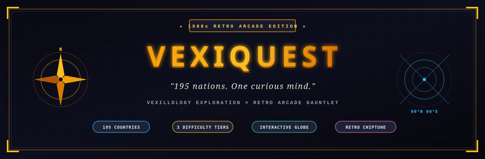
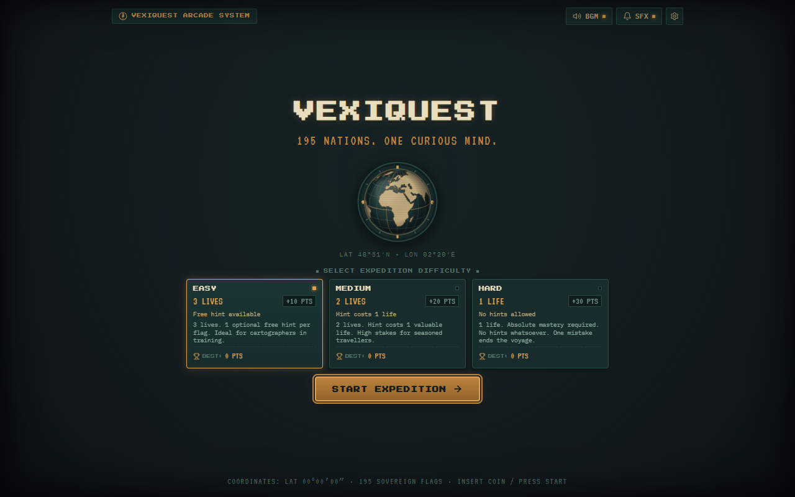
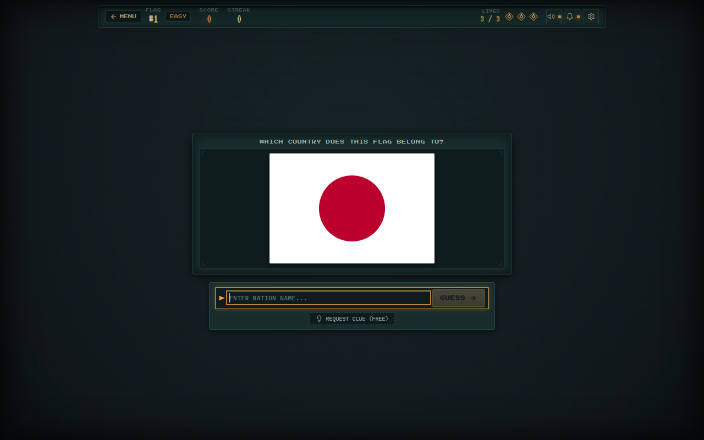
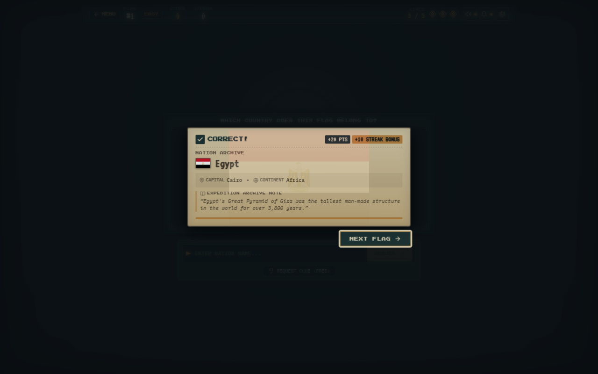
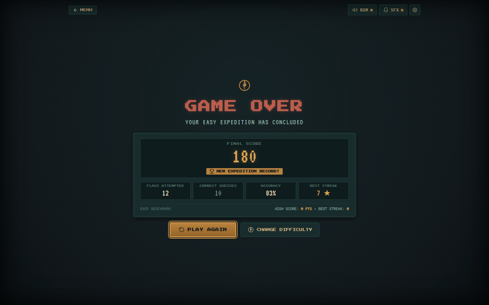

<div align="center">



# VEXIQUEST

> *"195 nations. One curious mind."*

**A retro arcade-inspired flag guessing expedition combining vexillological discovery, vintage treasure-map aesthetics, and endless streak-based gameplay.**

[](https://vexiquest.vercel.app)
[](https://react.dev)
[](https://www.typescriptlang.org)
[](https://vitejs.dev)
[](#development-status)

</div>

---

## 🗺️ About VexiQuest

**VexiQuest** is a flag-guessing game built around the study of **vexillology** — the history, symbolism, and usage of flags.

The experience fuses the visual soul of **1980s retro coin-op arcade cabinets** with the romantic mystery of **age-of-discovery cartography**. Complete with an orthographic 3D interactive wireframe globe, CRT scanline atmospheres, procedural 16-bit chiptune soundscapes, and comprehensive cultural trivia for every sovereign nation, VexiQuest transforms geography practice into a high-stakes, addictive gauntlet.

Whether you're practicing to distinguish the triband flags of West Africa or memorising micro-states in Oceania, each voyage presents fresh challenges, deep trivia, and persistent personal high-score milestones.

---

## 📸 Screenshots & Visual Walkthrough

<div align="center">

### 🏛️ The Voyage Hub (Home & Mode Select)
*Interactive 3D orthographic globe, difficulty mode selection, and persistent personal bests.*
<br/>


<br/><br/>

### 🕹️ The Flag Gauntlet (Gameplay Interface)
*High-fidelity vector flags, live streak flames, compass lives, and instant fuzzy-match input.*
<br/>


<br/><br/>

### 🧭 Discovery & Cultural Trivia (Fact Reveal)
*Educational trivia, capital cities, continents, and historical context unlocked with each answer.*
<br/>


<br/><br/>

### 🏆 Voyage Log & High Scores (Game Over)
*Post-voyage breakdown with accuracy metrics, streaks, score calculations, and record tracking.*
<br/>


</div>

---

## 🌟 Key Features

- **🌍 195 Sovereign Nations:** Complete database covering all 193 UN member states plus Vatican City and Palestine.
- **⚡ Three Difficulty Modes:** Hand-curated flag pools tailored for beginners (*Easy*), seasoned travellers (*Medium*), and vexillology masters (*Hard*).
- **🕹️ Endless Arcade Gameplay:** Dynamic randomized card decks with strict repeat prevention so flags don't repeat until the pool is exhausted.
- **💡 Adaptive Hint System:** Contextual geographical and cultural clues (free in Easy, life-costing risk/reward in Medium, disabled in Hard).
- **💖 Compass & Pixel Hearts:** Visual life counters with custom animations when taking damage or surviving near misses.
- **🔥 Consecutive Answer Streaks:** Score multipliers that reward sustained knowledge with streak counters and bonus fanfare.
- **📖 Rich Country Knowledge:** Every nation features curated historical facts, capital cities, geographic classifications, and common aliases.
- **🌐 Interactive 3D Canvas Globe:** Custom orthographic projection powered by D3-geo and TopoJSON, rotatable with pointer interaction.
- **🎵 Procedural 16-Bit Web Audio:** Warm retro chiptune melodies and tactile 80s arcade sound effects synthesised entirely in real time (zero bulky MP3/WAV assets).
- **💾 Local Storage Persistence:** Automatically tracks your high scores, best streaks, and total voyages across each difficulty tier.
- **📱 Responsive Layout:** Precision-fitted arcade presentation optimised for desktop, tablets, and mobile screens.

---

## 🧭 Difficulty Guide

| Difficulty | Nation Pool | Starting Lives | Points / Correct | Hint Rule | Target Audience |
| :--- | :---: | :---: | :---: | :--- | :--- |
| **🟢 Easy** | 48 Most Recognizable Flags | **3 Lives** | **10 pts** | 1 Free hint per flag | Beginners & Cartographers in training |
| **🟡 Medium** | 116 Recognizable + Regional Flags | **2 Lives** | **20 pts** | Hint costs **1 Life** | Seasoned world travellers |
| **🔴 Hard** | All 195 Sovereign Nations | **1 Life** | **30 pts** | **No hints allowed** | Vexillology scholars & arcade purists |

---

## 🛠️ Tech Stack

VexiQuest is built using modern, lightweight web technologies designed for instant loads and zero lag:

- **Core Framework:** [React 19](https://react.dev) (`react` + `react-dom`)
- **Type Safety:** [TypeScript 7](https://www.typescriptlang.org)
- **Bundler & Dev Server:** [Vite 8](https://vitejs.dev)
- **Linter:** [Oxlint](https://oxc.rs)
- **Cartography & 3D Globe:** [d3-geo](https://github.com/d3/d3-geo), [topojson-client](https://github.com/topojson/topojson-client), [world-atlas](https://github.com/topojson/world-atlas)
- **Flag Assets:** [flag-icons](https://github.com/lipis/flag-icons) & [svg-country-flags](https://github.com/stefangabos/world_countries)
- **Audio Synthesis:** Real-time Web Audio API (`AudioContext`, procedural oscillators, gain envelopes)
- **Deployment & Hosting:** [Vercel](https://vercel.com) with edge routing

---

## 🚀 Getting Started

Follow these steps to run VexiQuest locally on your machine.

### Prerequisites

- [Node.js](https://nodejs.org) (v18.0.0 or higher recommended, tested on Node 20+)
- `npm` (bundled with Node.js) or `pnpm` / `yarn`

### Installation

1. **Clone the repository:**
   ```bash
   git clone https://github.com/kazukazu7877/VexiQuest.git
   cd VexiQuest
   ```

2. **Install dependencies:**
   ```bash
   npm install
   ```

3. **Start the local development server:**
   ```bash
   npm run dev
   ```
   Open your browser and navigate to `http://localhost:5173/`.

4. **Create a production build:**
   ```bash
   npm run build
   ```

5. **Preview the production build locally:**
   ```bash
   npm run preview
   ```

---

## 📁 Project Structure

```text
VexiQuest/
├── docs/                      # Documentation assets & genuine game screenshots
│   ├── assets/                # Hero banner & social preview graphics
│   └── screenshots/           # Captured gameplay, reveal, and results screens
├── public/                    # Static public assets
│   ├── favicon.svg            # Pixel compass favicon
│   ├── icons.svg              # SVG sprites
│   └── flags/                 # Vector SVG country flags (195 nations)
├── src/
│   ├── assets/                # App icons & branding illustrations
│   ├── components/            # React UI components
│   │   ├── AudioControls.tsx       # Music & SFX toggle sliders
│   │   ├── CompassLives.tsx        # Compass & pixel heart health meters
│   │   ├── FlagCard.tsx            # Flag presentation & aspect ratio card
│   │   ├── GameOverScreen.tsx      # Results breakdown & high scores
│   │   ├── GameScreen.tsx          # Active guessing gauntlet
│   │   ├── HomeScreen.tsx          # Main voyage terminal & difficulty select
│   │   ├── Icons.tsx               # Pixel & retro arcade vector icons
│   │   ├── InfoCard.tsx            # Country facts & trivia reveal
│   │   ├── InteractiveGlobe.tsx    # D3-geo orthographic 3D canvas globe
│   │   ├── PixelHearts.tsx         # Heart damage indicators
│   │   └── VintageDecorations.tsx  # CRT border flourishes & parchment borders
│   ├── data/
│   │   ├── countries.ts            # Complete 195-country dataset (hints, trivia, capitals)
│   │   ├── difficultyPools.ts      # Tiered difficulty country partitions
│   │   └── flagRatios.json         # Accurate aspect ratio mappings for all flags
│   ├── types/
│   │   └── game.ts                 # Core TypeScript interfaces & configurations
│   ├── utils/
│   │   ├── answerChecker.ts        # Fuzzy matching, diacritics & alias handling
│   │   ├── gamePool.ts             # Deck shuffle & repeat prevention logic
│   │   ├── soundEngine.ts          # Procedural Web Audio chiptune & arcade synth
│   │   └── storage.ts              # LocalStorage persistent personal bests
│   ├── App.css                # Retro arcade styling, CRT filters & animations
│   ├── App.tsx                # Master state controller & screen router
│   ├── index.css              # Global typography & CSS reset
│   └── main.tsx               # React root entry point
├── package.json               # Dependencies and build scripts
├── tsconfig.json              # TypeScript compilation configuration
├── vercel.json                # Vercel deployment rewrite rules
└── vite.config.ts             # Vite bundler configuration
```

---

## ☁️ Deployment

VexiQuest is continuously deployed on **Vercel**:

- **Production URL:** [https://vexiquest.vercel.app](https://vexiquest.vercel.app)
- **Deployment Strategy:** Automated continuous deployment connected to the `main` branch. Every pushed commit triggers an automated build verification and atomic production rollout.

---

## 📜 Credits & Attributions

- **Flag Vector Graphics:** Distributed via [flag-icons](https://github.com/lipis/flag-icons) and [svg-country-flags](https://github.com/stefangabos/world_countries) under MIT / Public Domain licenses.
- **Geographic Datasets:** Country boundaries and land TopoJSON via [world-atlas](https://github.com/topojson/world-atlas) (Natural Earth public domain data).
- **Cartographic Projections:** Mathematics powered by [d3-geo](https://github.com/d3/d3-geo) (ISC License).
- **Sound & Music:** Custom procedural audio engine written specifically for VexiQuest using the native Web Audio API (no copyrighted audio files).
- **Icons & Visuals:** Custom-designed retro arcade SVG iconography.

---

## 🚦 Development Status

**Actively Developing 🛠️**

VexiQuest is an ongoing personal project. Planned additions include time-attack expedition modes, regional continental tournaments, daily challenges, and custom community flag packs.

---

<div align="center">
  <sub>Crafted with passion for geography and retro gaming.</sub>
</div>
