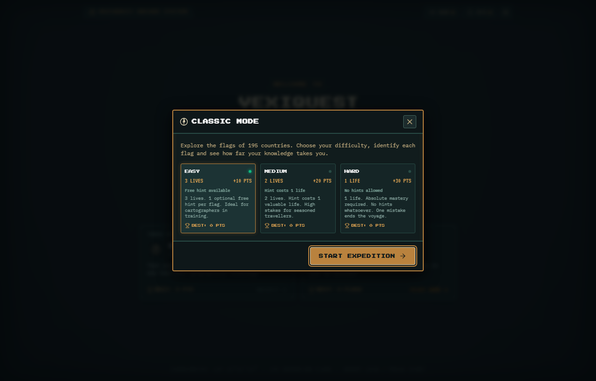
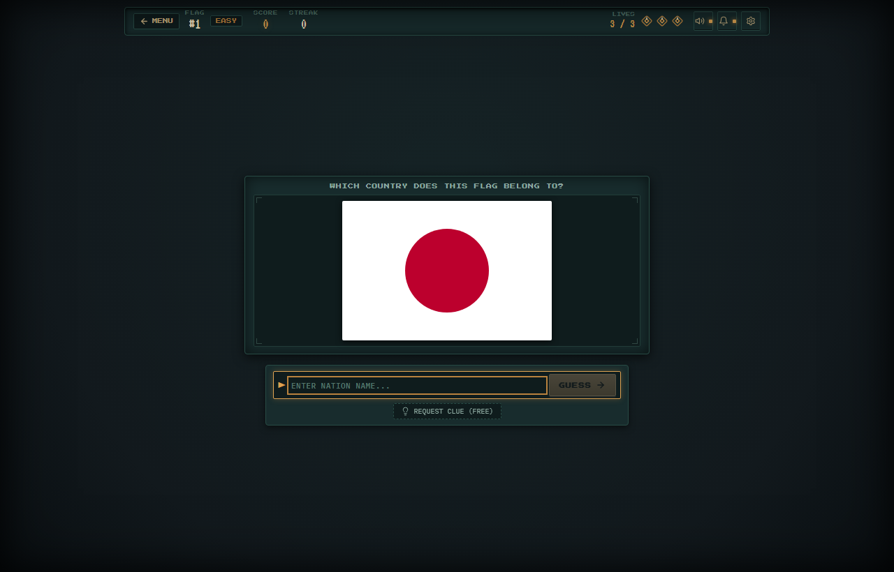
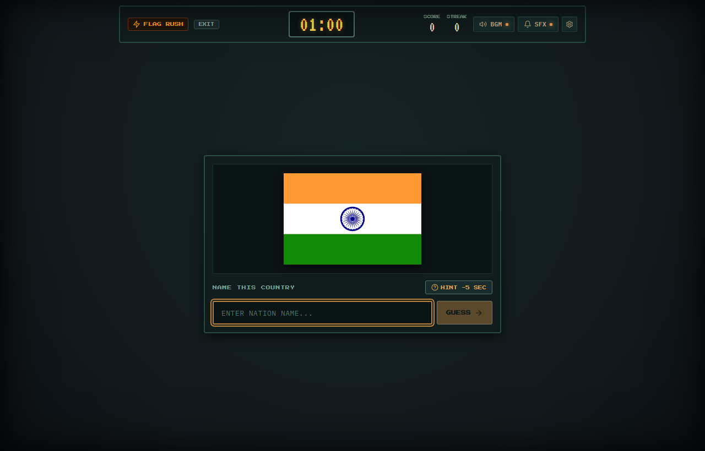
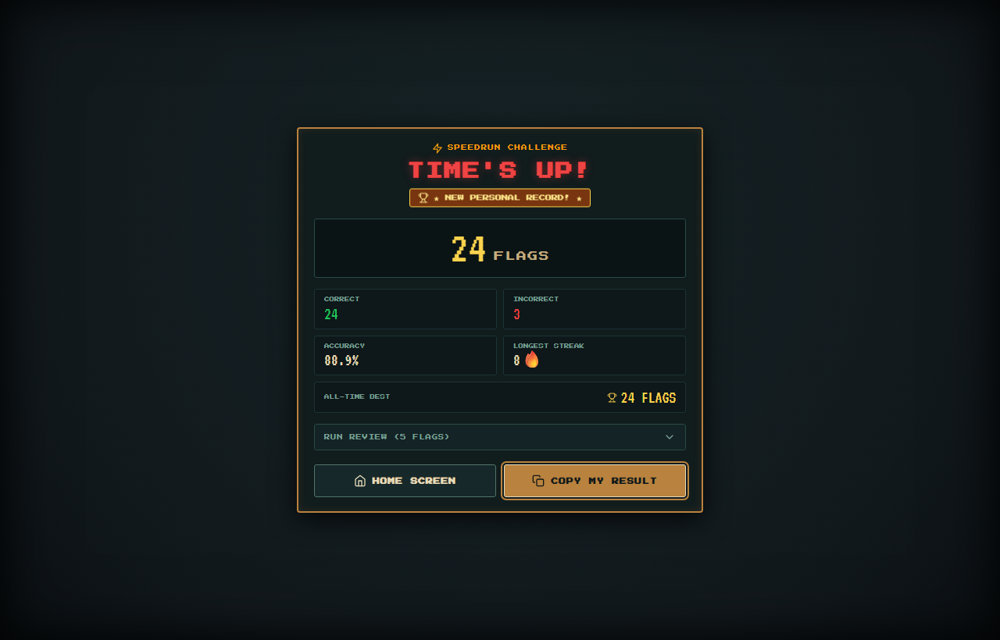
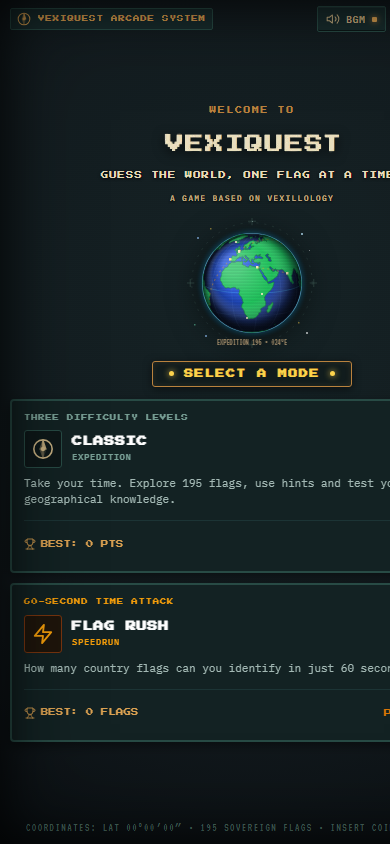

# VexiQuest

*Guess the world, one flag at a time.*

A game based on vexillology.

[Play Live Demo](https://vexiquest.vercel.app) · [Report an Issue](https://github.com/kazukazu7877/VexiQuest/issues)

[](https://vexiquest.vercel.app)
[](https://www.typescriptlang.org)
[](https://react.dev)
[](https://vitejs.dev)
[](#development-status)


*The Voyage Hub: interactive pixel-art Earth with spherical front-hemisphere lighting, mode selection, and persistent personal records.*

---

## About VexiQuest

**VexiQuest** is an independently developed retro arcade flag-guessing game built around the study of **vexillology**—the history, symbolism, and design of national flags.

Instead of a generic multiple-choice quiz, VexiQuest challenges you to recall and type nation names from memory. As you identify flags, you uncover geographic context, capital cities, and historical trivia for all 195 sovereign nations.

The game features two distinct game modes:

- **Classic Mode:** A continuous, thoughtful expedition across three curated difficulty tiers with lives, contextual clues, and streak multipliers.
- **Flag Rush:** A fast-paced 60-second arcade speedrun where you identify as many national flags as possible before the buzzer sounds.

Visually, VexiQuest combines a dark arcade cabinet aesthetic with antique cartographic details: pixel-art typography, an interactive rotating Earth with great-circle travel routes, CRT scanlines, and a 16-bit sound engine synthesized entirely in code with the Web Audio API.

---

## Game Modes

### 1. Classic Expedition
Take your time and explore the world. You are presented with flags drawn from a randomized deck with strict repeat prevention. Correct guesses award points and build streaks; mistakes deduct lives.

| Difficulty | Nation Pool | Starting Lives | Points / Flag | Clue Policy |
| :--- | :---: | :---: | :---: | :--- |
| **Easy** | 48 major flags | 3 Lives | 10 pts | 1 free clue per flag (+5 bonus pts if solved without clue) |
| **Medium** | 116 regional & emerging flags | 2 Lives | 20 pts | Clue costs 1 life |
| **Hard** | All 195 sovereign nations | 1 Life | 30 pts | No clues permitted |

After every guess, an **Expedition Discovery Card** appears with the country's official name, capital city, continent, and historical trivia.

### 2. Flag Rush (60-Second Speedrun)
A pure time-attack arcade challenge:
- **60-Second Clock:** Monotonically timed countdown using high-resolution browser performance timing.
- **Scoring:** +1 point per correct flag identified.
- **Clue Penalty:** Need help? You can request a clue at any time, but it immediately deducts 5 seconds from your remaining clock.
- **Wrong-Answer Feedback:** Immediate visual feedback revealing the correct answer before instantly cycling to the next flag.
- **Time's Up Review:** Comprehensive post-run breakdown featuring total attempts, accuracy percentage, longest streak, and a review log of every flag in your run.
- **Result Sharing:** One-click clipboard export to share your speedrun scorecard with friends.

---

## Features

### Gameplay & Database
- **Complete Sovereign Coverage:** All 193 UN member states plus Vatican City and Palestine (195 sovereign nations).
- **Freeform Typing with Alias Normalization:** Intelligent matching that recognizes official names, common colloquialisms, acronyms, and common variants (e.g., *USA*, *United States*, *America*, *South Korea*, *ROK*, *Côte d'Ivoire*, *Ivory Coast*).
- **Proportional Flag Rendering:** Accurate aspect ratios for rectangular, swallowtail, and unique flags (such as Nepal's double-pennant and Switzerland's square).
- **Repeat Prevention:** Randomized deck cycling ensures you never see duplicate flags until the entire pool has been exhausted.
- **Streak Bonuses:** Consecutive correct answers award bonus points and activate arcade flame indicators.

### Visuals & Audio
- **Interactive Pixel-Art Earth:** A rotating globe with accurate Natural Earth landmasses, vibrant ocean depths, great-circle exploration routes, and mathematically occluded far-side lighting. Supports mouse drag and touch rotation.
- **Hand-Crafted Pixel Wordmark:** Pixel-art brand lettering with retro amber accents.
- **Procedural Sound Engine:** Custom chiptune arpeggios, countdown beeps, buzzer sounds, and background music generated in real time using Web Audio oscillators—zero external MP3/WAV downloads required.
- **Handheld Mobile Feel:** Fully responsive layout tested on modern smartphones (375px to 414px) and tablets with comfortable 44px+ touch targets and zero horizontal overflow.
- **Local Persistence:** High scores, best streaks, and sound settings persist across browser sessions via `localStorage`.

---

## Screenshots

<div align="center">

### Mode Selection & Difficulty

*Classic Mode difficulty selector showing life counts, scoring rules, and personal best benchmarks.*

<br/>

### Classic Gameplay

*Flag guessing interface with vector flag mount, HUD streak tracker, and uppercase input field.*

<br/>

### Nation Discovery Archive

*Historical notes, capital city, and continental context unlocked after each guess.*

<br/>

### Flag Rush Speedrun

*High-intensity 60-second time attack with prominent clock and fast feedback.*

<br/>

### Time's Up Results

*Post-game speedrun scorecard with accuracy breakdown, run review, and one-click result copying.*

<br/>

### Handheld Mobile Experience

*Handheld console-style mobile layout with proportional touch controls and compact framing.*

</div>

---

## Tech Stack

- **Framework:** [React 19](https://react.dev)
- **Language:** [TypeScript 5.x](https://www.typescriptlang.org)
- **Bundler & Build Tool:** [Vite 8](https://vitejs.dev)
- **Cartographic Projections:** [d3-geo](https://github.com/d3/d3-geo) (Orthographic projection, great-circle interpolation, and spherical distance)
- **Geographic Data:** [TopoJSON Client](https://github.com/topojson/topojson-client) & [world-atlas](https://github.com/topojson/world-atlas) (Natural Earth 1:110m landmasses)
- **Flags:** Optimized vector SVGs sourced from [flag-icons](https://github.com/lipis/flag-icons)
- **Sound Synthesis:** Native Web Audio API (procedural square, triangle, and noise oscillators)
- **Typography:** Google Fonts (*Press Start 2P*, *IBM Plex Mono*, *VT323*)
- **Deployment:** [Vercel](https://vercel.com) (automatic continuous integration from `main`)

---

## Running Locally

### Prerequisites
- [Node.js](https://nodejs.org) (v18.0 or higher recommended)
- `npm` (included with Node.js)

### Quick Start

1. **Clone the repository:**
   ```bash
   git clone https://github.com/kazukazu7877/VexiQuest.git
   cd VexiQuest
   ```

2. **Install dependencies:**
   ```bash
   npm install
   ```

3. **Start the development server:**
   ```bash
   npm run dev
   ```
   Open `http://localhost:5173` in your browser.

4. **Run production build:**
   ```bash
   npm run build
   ```
   This executes `tsc -b` for strict type checking followed by Vite production bundling.

---

## Project Structure

```text
VexiQuest/
├── docs/                      # Documentation assets & screenshots
│   ├── assets/                # Social preview card (1200x630)
│   └── screenshots/           # In-game captures (homepage, modes, gameplay, results)
├── public/                    # Static public assets
│   ├── branding/              # Official VexiQuest pixel wordmark
│   ├── flags/                 # 195 optimized sovereign flag SVGs
│   ├── favicon.svg            # Crisp vector pixel-art tab favicon
│   ├── favicon.ico            # Multi-res ICO fallback (16, 32, 48)
│   ├── robots.txt             # Search crawler directives
│   ├── sitemap.xml            # Search engine sitemap
│   └── site.webmanifest       # PWA manifest with theme colors
├── src/
│   ├── components/            # UI components
│   │   ├── HomeScreen.tsx         # Voyage hub with mode cards
│   │   ├── InteractiveGlobe.tsx   # D3 orthographic canvas Earth
│   │   ├── GameScreen.tsx         # Classic Mode guessing stage
│   │   ├── GameOverScreen.tsx     # Classic Mode end screen
│   │   ├── FlagRushScreen.tsx     # 60-second speedrun stage
│   │   ├── FlagRushResults.tsx    # Time's Up scorecard & review
│   │   ├── ClassicInfoModal.tsx   # Difficulty selection overlay
│   │   ├── FlagRushInfoModal.tsx  # Speedrun rules overlay
│   │   ├── AudioControls.tsx      # Arcade sound & music toggles
│   │   └── FlagCard.tsx           # Proportional flag frame
│   ├── data/
│   │   ├── countries.ts           # 195-nation database (capitals, hints, facts)
│   │   ├── difficultyPools.ts     # Tiered nation sets for Easy, Medium, Hard
│   │   └── flagRatios.json        # Aspect ratios for accurate flag mounting
│   ├── types/
│   │   └── game.ts                # TypeScript game types and difficulty configs
│   ├── utils/
│   │   ├── answerChecker.ts       # Alias normalization & fuzzy matching
│   │   ├── gamePool.ts            # Randomized deck with repeat prevention
│   │   ├── soundEngine.ts         # Procedural Web Audio synth & SFX
│   │   └── storage.ts             # LocalStorage personal best persistence
│   ├── App.tsx                # Game coordinator & screen routing
│   └── main.tsx               # Application bootstrap
├── package.json
└── vite.config.ts
```

---

## Deployment

VexiQuest is deployed to **Vercel** with automatic continuous deployment on every push to the `main` branch.

- **Live Production URL:** [https://vexiquest.vercel.app](https://vexiquest.vercel.app)
- **Repository:** [https://github.com/kazukazu7877/VexiQuest](https://github.com/kazukazu7877/VexiQuest)

---

## Credits & Attribution

- **Flag Vector Assets:** Sourced from [flag-icons](https://github.com/lipis/flag-icons) and [svg-country-flags](https://github.com/stefangabos/world_countries) under MIT and Public Domain licenses.
- **Geographic Data:** Country TopoJSON boundaries from [world-atlas](https://github.com/topojson/world-atlas) (Natural Earth public domain datasets).
- **Projections:** Spherical mathematics and great-circle calculations powered by [d3-geo](https://github.com/d3/d3-geo) (ISC License).
- **Sound Engine:** Procedural square and triangle wave synthesizer built with the native browser Web Audio API.
- **Fonts:** *Press Start 2P*, *IBM Plex Mono*, and *VT323* licensed under the SIL Open Font License via Google Fonts.

---

## Development Status

**Actively Developing.**

VexiQuest is an ongoing independent project. Future updates will focus on regional exploration challenges, continent-specific expeditions, and daily flag puzzles.
